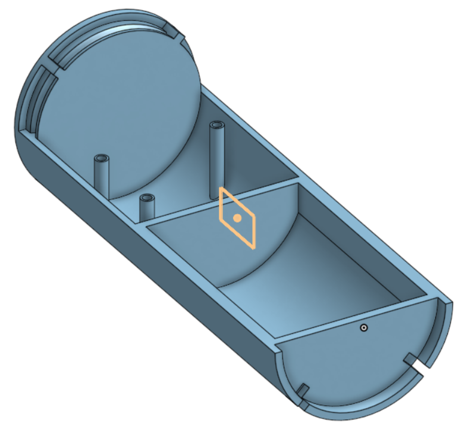
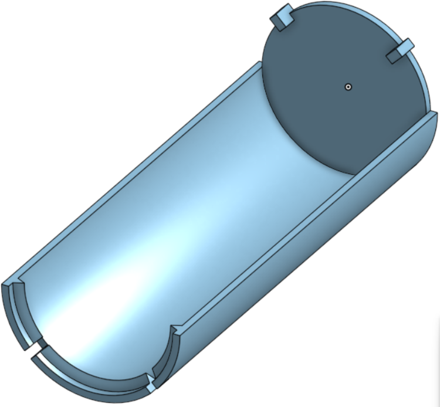

# Iiiriomote/Abracadibri

### /HID/Joystick/Game-stick/key-stick/\*

It was fun to use a wiimote with the wii, but it's nativs to only the wii. I want to play Beat Saber on PC, but it only supports VR. How to bridge all this? Make a similar HID ofc!

> Based on cutting edge RF Tech with native gesture binding support, bringing a seamless Experience to IMU based HIDs.

If I were a company witha big r&d team that might be it. but no, I'm a **chief hardware junior** so it's times worse.

### Features

- 2 + 1D output
- solid IMU tracking with less than .5mm error at any given time
- Adjustable sensitivity or at least a nice level of sensiticity.
- ergo form factor
- USB C + **_Wireless_** connectivity (BLE6)
- Z-axis gestures

### Choice of MCU

nRF54l15 - FPU + Low latency Wirelesses.

### PCB

`Schematic`

`Layout`

### 3D Design

`Main`

`Lid`

### BOM

| Name                  | Qty | Unit  | Price  | Total  | Link                                                  |
| --------------------- | --- | ----- | ------ | ------ | ----------------------------------------------------- |
| 2000mAh LiPo with NTC | 1   | pcs   | 5.35   | 5.35   | https://www.aliexpress.com/item/1005008638516854.html |
| WeAct Mini Debugger   | 1   | pcs   | 3.48   | 3.48   | https://www.aliexpress.com/item/1005005303809188.html |
| or                    |     |       |        |        |                                                       |
| J-link Clone          | 1   | pcs   | 19.21  | 19.21  | https://www.aliexpress.com/item/1005008248107434.html |
| PCB(3/2A)             | 1   | order | 112.34 | 112.34 |                                                       |
| Case Printing         | 1   | pcs   |        |        |                                                       |
| Total                 |     |       |        | 139.38 | TBF                                                   |

[BOM](bom.csv)

### Code

nRF Connect SDK Using C/C++. I'm not confident in my Cxxxx skills so IDK. I chose this because it is native for nRF MCU.

Using standard zephyr sensor & RTIO libs + a custom(?) nRF HoG Profile.

### Differece to or from a Wiimote

uhh

Connects seamlessly to any BLE HoG(basically Bluetooth for peripheral) compatible device.
Open
Modern
